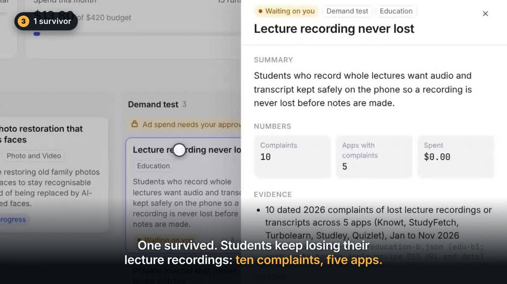

# Keiretsu

**Factories that run themselves. One person holds the switch.**

A keiretsu is a family of businesses in different industries run as one group. This one is a set of autonomous factories that turn AI work into revenue, with a human holding the keys.

[](ui/demo/keiretsu.mp4)

*One idea's morning, from a complaint in an app review to a decision waiting on you, in 54 seconds ([`ui/demo/keiretsu.mp4`](ui/demo/keiretsu.mp4)).*

## How it works

Every factory is a line of stages. Each run of Claude Code does one stage, writes what it found to files, and stops.

1. **Find ideas** in real evidence, such as complaints in app reviews or patterns in market data.
2. **Kill the weak ones cheaply.** A critic screens every idea, and most die here. That is the point: many cheap shots, one winner.
3. **Test before building.** An app idea faces a demand test, a trading strategy a backtest and a one-time final exam.
4. **Build** what survives, with its own tests.
5. **Stop at the gate.** Anything that spends money, publishes or goes live waits for a person. The run writes an approval packet and moves on to other work.
6. **Grow the winners** from real numbers.

State lives in plain files ([`factories/_shared/CONVENTIONS.md`](factories/_shared/CONVENTIONS.md)), so every step can be read, reviewed and replayed. The design is in [`ARCHITECTURE.md`](ARCHITECTURE.md) and the research behind it in [`RESEARCH_REPORT.md`](RESEARCH_REPORT.md).

## Why it is safe

- **Kill switches.** A `STOP` file at the root stops everything, and one in a factory's folder stops that factory. Every run checks before it starts. The console has a switch per factory that writes that file.
- **Budgets.** Each factory has monthly caps in `budget.yaml` and a cap per run. A run that would pass a cap does not start, and three failed runs in a row stop the factory.
- **Human gates.** Ad spend, publishing, store submission, real-money trades and new accounts each need an approval packet that a person moves to `approved/`. Until accounts exist, paid steps run dry.
- **Reviewed changes.** Every pull request is checked by CI and by an independent reviewer ([`REVIEW.md`](REVIEW.md)). Changes that touch money, keys, launches, guardrails or the review rules wait for the owner.

## The factories

| Factory | What it makes | Status |
|---|---|---|
| [Apps](factories/a-consumer-apps/) | iOS apps and web products, found in real complaints and tested with paid traffic | Built end to end. Test runs only, paid steps dry. No revenue yet |
| [Trading](factories/c-trading/) | Trading strategies that must pass a backtest gate, a final exam and paper trading | Engine built and tested on crypto data. Paper only, no real money |
| [E-commerce](factories/b-ecommerce/) | Single-product stores | Blueprint |
| [Directories](factories/d-directories/) | Niche directory sites built on verified data | Blueprint |
| [Outbound](factories/e-outbound/) | Demos built for qualified accounts, sent by a person | Blueprint |
| [Actors](factories/f-apify-actors/) | Scrapers published to a marketplace | Blueprint |

Micro-SaaS and browser extensions ([`g-marketplace-tools`](factories/g-marketplace-tools/)) are folded into the app factory.

## The console

[`ui/`](ui/) is the Keiretsu console, a local page over the factories' files. It reads them and changes nothing except a factory's off switch.

- **Board**: what needs you, spend against budget, and one column per stage with every idea in it.
- **Live**: all factories on one screen around you. An amber line means a factory is waiting on you. Click a factory to zoom into its line.

## Getting started

```
pip install -r requirements-dev.txt
python ui/serve.py                 # the console, at http://127.0.0.1:8765
```

Run state is committed on the `factory-state` branch. To see real runs, point the console at a checkout of it: `python ui/serve.py --root <that checkout>`.

**Run a factory by hand.** Nothing is scheduled. One command runs one stage, with Claude Code installed:

```
python3 tools/factory_run.py --factory a-consumer-apps --stage gap-mining
```

The stages and what each needs are in [`factories/a-consumer-apps/README.md`](factories/a-consumer-apps/README.md). The trading factory's daily job is started by hand from the Actions tab.

**Add a factory.** Create `factories/<name>/` with the files in the shared conventions (`FACTORY_SPEC.md`, `CLAUDE.md`, `ESCALATION.md`, `budget.yaml`, `skills/`). It shows up in the console at once, as planned until it has items or runs. Name and order its stages in [`ui/factories.yaml`](ui/factories.yaml).

**Change the code.** Read [`CLAUDE.md`](CLAUDE.md) and [`REVIEW.md`](REVIEW.md) first.
